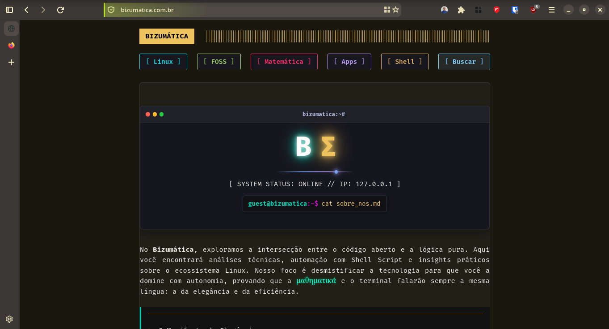

# 🎨 Firefox Gruvbox GNOME


> Tema Gruvbox vívido e acessível para o Firefox, aplicado sobre o firefox-gnome-theme: cores vivas, texto legível e foco sempre visível.

O **Firefox Gruvbox GNOME** reúne em uma única pasta `chrome/` a paleta Gruvbox com cores mais vivas, o mapeamento das variáveis do [firefox-gnome-theme](https://github.com/rafaelmardojai/firefox-gnome-theme) e um `user.js` opcional de privacidade e desempenho. Cada cor foi conferida pela razão de contraste WCAG.



---

## 🎨 Filosofia & Estética

* **Gruvbox Vívido:** fundo escuro (`#1d2021`) com acentos saturados, para as cores "saltarem" sem cansar a vista.
* **Acessibilidade Primeiro:** contraste mínimo de 4,5:1 no texto, anel de foco sempre visível, seleção de texto sólida e `prefers-reduced-motion` respeitado.
* **Status de Segurança Visível:** a barra de endereço ganha um gradiente curto e uma barra lateral que mudam de cor conforme a conexão. O ícone do Firefox (cadeado ou aviso) continua ali, então a informação não depende só da cor.
* **Leve e Sem Extensões:** tudo é CSS. Nada de extensão extra consumindo memória.

---

## 🛠️ Componentes

| Componente | Tecnologia | Papel |
| --- | --- | --- |
| **`userChrome.css`** | CSS (interface do Firefox) | Barra de endereço, gradiente de status, foco e botão do motor de busca |
| **`userContent.css`** | CSS (páginas internas) | `about:preferences`, `about:addons`, `about:config`, nova aba e outras |
| **`gruvbox.css`** | Variáveis CSS | Paleta única e mapeamento das variáveis do tema GNOME |
| **`firefox-gnome-theme/`** | Submódulo git | Base visual (repositório do autor do tema) |
| **`profile/user.js`** | Preferências (base Betterfox) | Opcional: telemetria zero, privacidade e desempenho |

---

## 📁 Estrutura do Repositório

```
<perfil>/chrome/
├── userChrome.css
├── userContent.css
├── gruvbox.css
├── firefox-gnome-theme/     ← submódulo (repositório do autor do tema)
├── profile/user.js          ← opcional; vai na raiz do perfil, não em chrome/
└── docs/                    ← capturas de tela
```

---

## ✅ Requisitos

* **Firefox:** usado no dia a dia no **Firefox 157, em Linux**. No Windows deve funcionar (o tema GNOME tem ajustes próprios para a plataforma), mas ainda não foi testado.
* **Git** instalado.
* **Versão do tema GNOME:** ele muda de seletores a cada versão do Firefox. O repositório fixa o tema em um commit; confira qual com `git submodule status`.
* **Sem a extensão Adaptive Tab Bar Colour:** o mapeamento daqui pinta janela, barras e menus de forma fixa e conflita com ela.

---

## 🏗️ Instalação

#### 1. Descubra a pasta do perfil

Feche o Firefox, abra `about:support` e veja a linha "Pasta do perfil".

#### 2. Clone com o nome `chrome`

```bash
cd ~/.config/mozilla/firefox/XXXX.default-release   # troque pela sua pasta
mv chrome chrome.bak 2>/dev/null                    # só se já existir uma
git clone --recurse-submodules https://github.com/bizumatica/firefox-gruvbox-gnome.git chrome
```

No Windows, a pasta do perfil fica em `%APPDATA%\Mozilla\Firefox\Profiles\XXXX.default-release`. Os comandos do `git` são os mesmos no Git Bash ou no PowerShell.

#### 3. Ative as preferências

No `about:config`, crie ou confirme como `true` (se você usar o `profile/user.js`, elas já vêm nele):

* `toolkit.legacyUserProfileCustomizations.stylesheets`
* `svg.context-properties.content.enabled` (sem ela, os ícones do tema ficam pretos)

#### 4. Tema escuro e reinício

Deixe o sistema em **tema escuro** (no Linux, o tema GTK; no Windows, Configurações > Personalização > Cores) e reinicie o Firefox por completo.

#### `user.js` (opcional)

O `profile/user.js` é para a **raiz do perfil**, não para `chrome/`:

```bash
cp chrome/profile/user.js user.js    # dentro da pasta do perfil
```

Leia antes de aplicar: ele ativa HTTPS-Only e bloqueia notificações e localização por padrão, entre outras coisas. No topo há o bloco **"ESCOLHA O PERFIL DE MEMÓRIA"**, com dois perfis (8 GB ou mais com SSD, e 6 GB ou menos). Deixe só um ativo. O arquivo vale para Firefox, Floorp e Zen; o CSS deste repositório é só para o Firefox.

---

## 🔄 Atualização

#### Esta configuração

```bash
cd <perfil>/chrome
git pull --recurse-submodules
```

#### O tema GNOME

Traz a versão mais nova do autor, o que pode quebrar algo. Teste antes de manter:

```bash
git submodule update --remote firefox-gnome-theme
```

---

## 🎛️ Personalização

* **Cores:** edite `gruvbox.css`. Para mudar o amarelo, altere `--gb-accent` (e seus `-hover` e `-active`). Mantenha pelo menos 4,5:1 de contraste entre `--gb-accent` e `--gb-on-accent`.
* **Fundo mais claro:** troque `--gb-bg` de `#1d2021` para `#282828`.
* **Opções do tema GNOME:** são booleanos no `about:config` (ou no `user.js`). A lista completa está no [repositório do tema](https://github.com/rafaelmardojai/firefox-gnome-theme#enabling-optional-features).
  * Combinam bem: `gnomeTheme.activeTabContrast`, `gnomeTheme.tabAlignLeft`, `gnomeTheme.normalWidthTabs`, `gnomeTheme.closeOnlySelectedTabs`.
  * Evite: `gnomeTheme.systemIcons` (bug de cor conhecido), `gnomeTheme.oledBlack` (o mapeamento daqui o sobrescreve) e `gnomeTheme.extensions.adaptiveTabBarColour` (conflita com as cores fixas).

---

## ♿ Acessibilidade

Contraste calculado sobre o fundo `#1d2021`:

| Elemento | Contraste |
| --- | --- |
| Texto principal | 14,5:1 |
| Texto secundário | 9,6:1 |
| Amarelo de destaque | 10,4:1 |
| Texto escuro sobre botão amarelo | 10,4:1 |
| Verde / aqua / azul / roxo / laranja | 7,0:1 a 10,7:1 |
| Vermelho | 5,3:1 |
| Borda de campos de texto | 3,4:1 |

Também: foco sempre visível, seleção de texto sólida, `prefers-reduced-motion` respeitado e um bloco para o modo de cores forçadas (Alto Contraste do Windows).

---

## 🩺 Solução de Problemas

#### O tema GNOME não aparece

1. A pasta se chama exatamente `chrome` e fica dentro do perfil?
2. `chrome/firefox-gnome-theme` está vazia? Rode `git submodule update --init`.
3. `toolkit.legacyUserProfileCustomizations.stylesheets` está `true`?
4. Fechou o Firefox por completo e abriu de novo?
5. Teste: acrescente `#nav-bar { background: red !important; }` ao fim do `userChrome.css` e reinicie. Se a barra ficar vermelha, o CSS carrega e o problema é o tema; se não, é a preferência ou a pasta do perfil.

#### Botões das páginas `about:` com texto escuro sobre fundo escuro

O `userContent.css` já força `color-scheme: dark` nessas páginas. Se persistir, coloque o sistema em tema escuro.

#### O botão do motor de busca na barra de endereço continua claro

O seletor usado (`#urlbar-searchmode-switcher`) pode mudar entre versões do Firefox. Para achar o nome certo: `F12` > opções > marque "Enable browser chrome and add-on debugging toolboxes" e "Enable remote debugging", feche e aperte `Ctrl+Alt+Shift+I`. Passe o seletor de elementos sobre o botão e ajuste a seção 6 do `userChrome.css`. Abra uma *issue* informando o `id` ou a classe.

#### Quebrou depois de atualizar o Firefox

Comece por `#urlbar-background` e pelas variáveis `--toolbar-field-*`, e veja se há uma versão nova do tema GNOME para a sua versão do Firefox.

---

## 🙏 Créditos & Licença

* [firefox-gnome-theme](https://github.com/rafaelmardojai/firefox-gnome-theme), de Rafael Mardojai CM: a base deste visual. Tem licença própria; consulte o `LICENSE` dele.
* [Gruvbox](https://github.com/morhetz/gruvbox), de morhetz: a paleta original. As cores aqui foram deixadas mais vivas e conferidas quanto ao contraste.
* [Betterfox](https://github.com/yokoffing/Betterfox), de yokoffing: base do `profile/user.js`.

Os arquivos deste repositório (CSS e `user.js`) estão sob a licença MIT (veja `LICENSE`).

---

**Mantenedor:** Julio Prata (BackInBash)

 